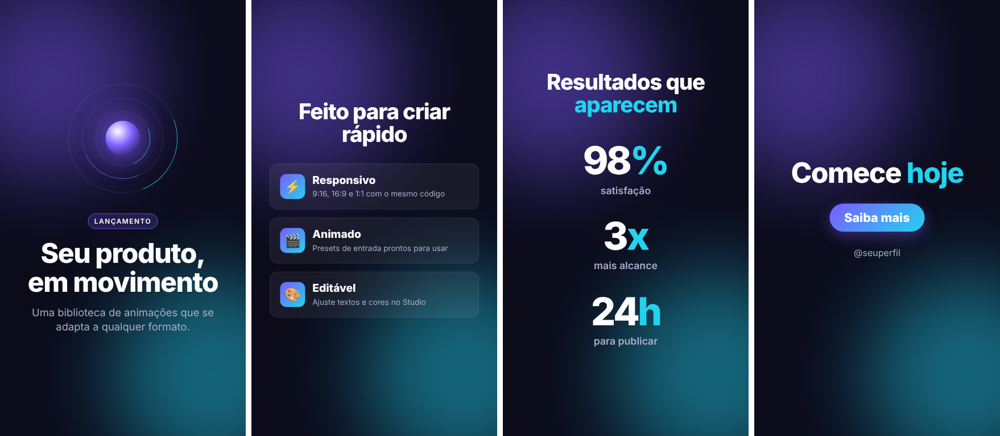

# Motion Design Library

Biblioteca de motion design responsiva feita com [Remotion](https://www.remotion.dev).
Escreva uma cena uma vez e exporte em **9:16 (formato principal)**, **16:9** e **1:1** sem reconstruir nada.

| 9:16 | 16:9 | 1:1 |
| --- | --- | --- |
| Reels, TikTok, Shorts | YouTube, apresentações | Feed |



## Documentação — por onde começar

| Documento | Para quê |
| --- | --- |
| [PRODUCTION_WORKFLOW.md](PRODUCTION_WORKFLOW.md) | iniciar uma produção a partir de um roteiro (passo a passo + comando de exemplo) |
| [MASTER_STYLE_GUIDE.md](MASTER_STYLE_GUIDE.md) | regras da identidade: tempo, curvas, tipografia, composição, estilos, áudio, formatos |
| [docs/biblioteca-motion.md](docs/biblioteca-motion.md) | referência técnica da biblioteca `src/motion` |
| [docs/estendendo-a-biblioteca.md](docs/estendendo-a-biblioteca.md) | adicionar componentes, presets, transições e temas |
| [reference-library/README.md](reference-library/README.md) | cadastrar e analisar referências audiovisuais |
| [CLAUDE.md](CLAUDE.md) | instruções para sessões de IA (consultar a biblioteca, não reconstruir) |

Comandos principais:

```bash
npm run catalogo          # o que existe na biblioteca
npm run nova-producao -- --nome "Minha peça" --roteiro roteiro.md --formatos 9x16 --estilo calmo
npm run validar           # eslint + tsc + catálogo
npm run analisar-referencia -- video.mp4 --id ref-003-descricao-9x16
```

## Biblioteca de motion (`src/motion`) — novo

Tokens de animação medidos nas referências, revelação de texto por letra/palavra, troca de textos com saída em desfoque,
transições `radialReveal` e `blurDissolve`, entrada de objetos com peso, composições em camadas e temas **base**, **calmo** e **vibrante**.

- Documentação: [docs/biblioteca-motion.md](docs/biblioteca-motion.md)
- Demonstração: [docs/demo/demo-9x16.mp4](docs/demo/demo-9x16.mp4) · no Studio, **Biblioteca-Motion › Demo-9x16**
- Trilha: `python3 scripts/gerar-trilha.py` (sintetizada a partir de `src/demo/timeline.json`)

## Começando

Requisitos: Node.js 20.19+ ou 22.13+.

```bash
npm install
```

```bash
npm run dev
```

O Remotion Studio abre no navegador. As composições ficam em três pastas:

| Pasta | Conteúdo |
| --- | --- |
| **Video** | O vídeo de demonstração completo em `Vertical-9x16`, `Horizontal-16x9` e `Quadrado-1x1` |
| **Cenas** | Cada cena sozinha, com textos editáveis no painel de props |
| **Exemplos** | Uso mínimo da biblioteca em 4 formatos (incluindo 4:5) e o catálogo de presets |

### Exportar

```bash
npm run render:vertical
```

```bash
npm run render:horizontal
```

```bash
npm run render:quadrado
```

Os arquivos vão para `out/`, que não é versionada. Também dá para exportar pelo botão **Render** do Studio.

## Como a responsividade funciona

1. **Formato detectado pela proporção.** `useLayout()` lê a largura e a altura da composição e devolve `format` (`vertical`, `horizontal` ou `square`). Qualquer resolução funciona: 720×1280 também é `vertical`.
2. **Pixels de design.** Todos os tamanhos são escritos pensando numa tela de 1080 px no lado menor, e `px()` converte para o tamanho real. Um título `size={110}` tem a mesma presença nos três formatos.
3. **Valores por formato.** `pick({vertical, horizontal, square})` escolhe um valor por formato (`square` usa o valor de `vertical` quando é omitido). `Stack` e `Grid` aceitam esses objetos direto.
4. **Área segura própria.** `<SafeArea>` aplica margens de cada formato. No 9:16, o topo e a base ficam livres por causa da interface dos apps.

```tsx
import {SafeArea, Stack, Title, Paragraph, useLayout} from './lib';

export const MinhaCena = () => {
  const {pick} = useLayout();
  return (
    <SafeArea>
      {/* Coluna no 9:16 e 1:1, linha no 16:9 */}
      <Stack gap={{vertical: 60, horizontal: 120}}>
        <Title size={pick({vertical: 120, horizontal: 110})}>
          Olá, *mundo*
        </Title>
        <Paragraph delay={0.6}>Texto de apoio</Paragraph>
      </Stack>
    </SafeArea>
  );
};
```

Para usar outro formato, registre o mesmo componente com outras dimensões em `src/Root.tsx`.

## Conteúdo da biblioteca

| Peça | O que faz |
| --- | --- |
| `SafeArea`, `Stack`, `Grid` | Layout que muda de direção e de colunas por formato |
| `Title` | Título com entrada palavra por palavra; `*palavras*` ficam destacadas |
| `Paragraph`, `Pill` | Texto de apoio e etiqueta |
| `Counter` | Número que conta até o valor final (formatação pt-BR) |
| `FeatureCard` | Cartão com ícone em cima no 16:9 e à esquerda no 9:16 e no 1:1 |
| `CtaButton` | Botão com pulso suave |
| `GlowBackground`, `Orb` | Fundo animado e elemento visual |
| `useEntrance()` | 8 presets de entrada: `fade`, `fade-up`, `fade-down`, `slide-left`, `slide-right`, `scale`, `pop`, `blur` |

Os componentes de texto e dados aceitam `delay` (segundos) e `preset`, e são editáveis no Studio. Cores e fonte da v1 ficam em `src/lib/theme.ts` (legado; a identidade atual está em `src/motion/themes.ts` e no `DESIGN.md`).

## Estrutura

```
src/
  lib/                 Biblioteca (importe tudo de './lib')
    layout.ts          useLayout, formatos, áreas seguras, px() e pick()
    animations.ts      useEntrance, useProgress e presets de entrada
    theme.ts           Cores e fonte
    components/        Componentes de layout, texto, dados e decoração
  scenes/              Cenas prontas (abertura, recursos, números, encerramento)
  examples/            Exemplos de uso mínimo e catálogo de presets
  DemoVideo.tsx        Vídeo de demonstração (mesmo componente nos 3 formatos)
  Root.tsx             Registro das composições
docs/
  componentes.md       Referência de props de cada componente e cena
  presets.md           Presets de entrada, formatos, áreas seguras e tema
  analise-de-formatos.md  Decisões de design e verificação visual
  assets/              Imagens de demonstração dos três formatos
```

## Documentação

- [Componentes](docs/componentes.md)
- [Presets](docs/presets.md)
- [Análise de formatos](docs/analise-de-formatos.md)

## Licença

Uso privado. O Remotion é gratuito para pessoas físicas e equipes de até 3 pessoas. Empresas maiores precisam de licença: veja [remotion.dev/license](https://www.remotion.dev/docs/license).
