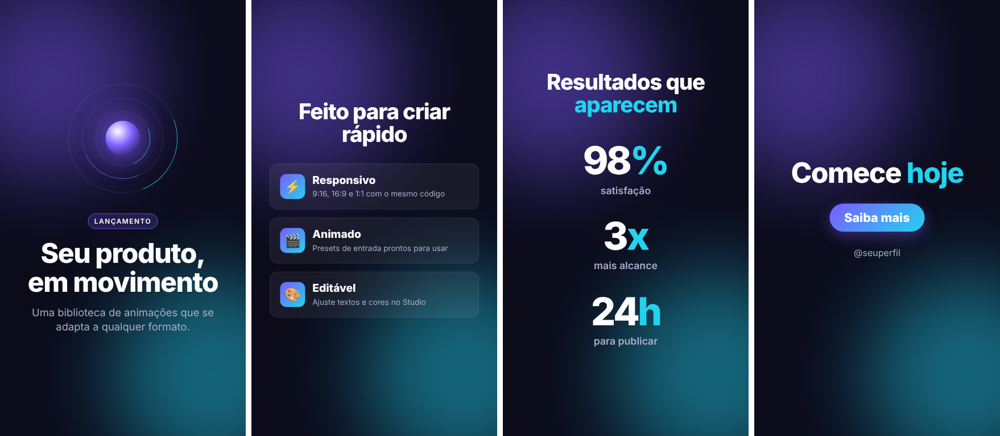

# Análise de formatos

Registro das decisões de design responsivo e da verificação visual dos três formatos.

## Problema

Um vídeo pensado para 9:16 não pode ser simplesmente esticado ou cortado para 16:9 e 1:1:

- **Tamanho:** em pixels fixos, um título de 110 px no 9:16 fica minúsculo num 4K ou enorme num 720p.
- **Composição:** o que cabe empilhado numa tela alta precisa ir para o lado numa tela larga.
- **Áreas seguras:** cada plataforma cobre partes diferentes da tela.

## Decisões

| Decisão | Motivo |
| --- | --- |
| Unidade baseada no **lado menor** (`min(w, h) / 1080`) | Texto mantém a mesma presença em 1080×1920, 1920×1080 e 1080×1080. Usar a largura deixaria o texto 78% maior no 16:9. |
| Formato detectado pela **proporção**, não pela resolução | 720×1280 e 2160×3840 funcionam sem configuração. |
| `pick()` com `square` caindo para `vertical` | O 1:1 costuma se parecer mais com o 9:16 (empilhado), então só precisa de valor próprio quando diferente. |
| Layout por componentes (`Stack`, `Grid`) em vez de `if (formato)` espalhados | As cenas descrevem a intenção uma vez, e a adaptação fica centralizada. |
| Distâncias de animação em pixels de design | O movimento tem o mesmo peso em todos os formatos. |
| Direção da transição por formato | Slide de baixo no vertical (gesto natural de rolagem) e da direita no horizontal. |

## Verificação visual

Quadros 95, 200, 320 e 420 de cada formato (Abertura, Recursos, Números, Encerramento):

### 9:16

### 16:9

### 1:1

### Resultados

- Nenhum texto passa da área segura nos três formatos.
- Abertura: o orbe muda de posição (em cima → à direita) e o alinhamento do texto muda (centro → esquerda) sem duplicar código.
- Recursos: grade de 1 → 3 colunas; no 1:1 os cartões usam escala 0,72 para caber empilhados.
- Números: coluna no 9:16; linha no 16:9 e no 1:1.
- Defeito encontrado e corrigido: o destaque com várias palavras (`*em movimento*`) só funcionava com uma palavra.

## Limitações conhecidas

- Os tamanhos são calculados por código (`px()`), por isso o `fontSize` não é editável diretamente no Studio. Os campos `size`, `color`, `delay` e `preset` de cada componente são.
- No 16:9, os textos dos cartões de recurso ficam pequenos (34 px de design em cartões estreitos). Se o texto for longo, aumente `size` ou reduza o conteúdo.
- Formatos muito largos (21:9) ou muito altos (1:3) são tratados como 16:9 e 9:16, sem layout próprio.
