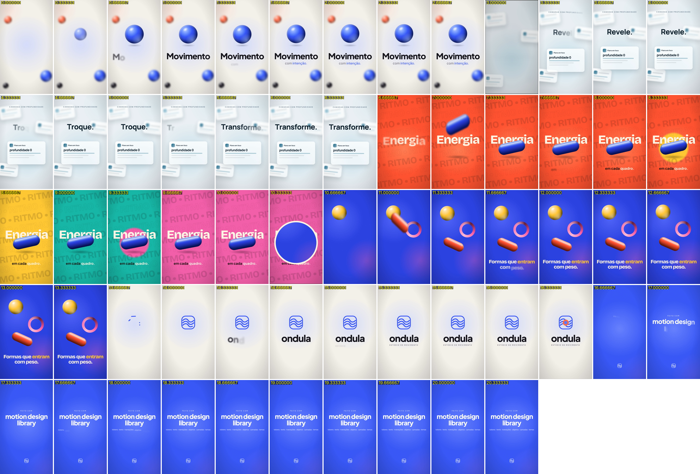

# Biblioteca de motion (`src/motion`)

Biblioteca de motion design construída a partir dos padrões **recorrentes** das referências
([análise](referencias/analise-referencias.md), [reference-library](../reference-library/README.md)).
Tudo é importado de um único ponto, `src/motion/index.ts` (use o caminho relativo a partir do seu arquivo):

```tsx
import {MotionProvider, TextReveal, TextSwap, ObjectEnter, radialReveal, blurDissolve, motionTiming, Layer, Backdrop, textPresets} from './motion';
```

**Documentos relacionados:**

- [MASTER_STYLE_GUIDE.md](../MASTER_STYLE_GUIDE.md): as regras da identidade (o quê).
- [PRODUCTION_WORKFLOW.md](../PRODUCTION_WORKFLOW.md): do roteiro ao vídeo (o processo).
- [estendendo-a-biblioteca.md](estendendo-a-biblioteca.md): como adicionar componentes, presets, transições e temas.
- **Catálogo consultável:** `npm run catalogo` (fonte: `src/motion/catalog.ts`).



Demonstração renderizada: [`docs/demo/demo-9x16.mp4`](demo/demo-9x16.mp4) (1080×1920, 30 fps, 20,6 s, com trilha).
No Studio: **Biblioteca-Motion › Demo-9x16**.

## Princípios

1. **Tempo em segundos, espaço em pixels de design.** Durações viram quadros no uso (funcionam em qualquer fps). Distâncias e desfoques usam a base de 1080 px no lado menor, convertida por `px()`, então a mesma animação tem o mesmo peso em 9:16, 16:9 e 1:1.
2. **Tokens com origem declarada.** As **durações** e a **sobra** vêm de medições das referências (tabela abaixo). O desfoque, as distâncias e o escalonamento foram calibrados visualmente na demonstração, porque as referências filmadas não permitem medi-los com precisão.
3. **Tudo configurável por instância.** Duração, intensidade, direção, escala e velocidade podem ser trocadas em cada componente sem mexer nos tokens.
4. **Temas trocam valores, não comportamento.** Base, calmo e vibrante usam as mesmas peças.

## Arquitetura

```
src/motion/
  tokens.ts            durações, escalonamento, desfoque, distâncias, sobra
  easing.ts            curvas nomeadas + mola com sobra controlada
  themes.ts            base, calmo, vibrante + createTheme() e blendThemes()
  presets.ts           presets nomeados de texto, objeto e transição
  catalog.ts           catálogo consultável (validado contra index.ts)
  MotionProvider.tsx   contexto de tema + useMotion() + useProgress()
  text/                TextReveal, TextSwap
  object/              ObjectEnter
  transitions/         radialReveal, blurDissolve, motionTiming
  layers/              Layer, Backdrop, KineticType, ColorBloom
  index.ts             ponto único de importação
src/producoes/          produções: _runtime/ (roteiro → animatic) + uma pasta por produção
src/demo/               demonstração (objetos originais, cenas, timeline.json)
src/lib/layout.ts       useLayout, px(), pick(), área segura (compartilhado)
src/lib/components/     biblioteca v1 (legado: não use em produções novas)
scripts/                nova-producao, catalogo, analisar-referencia, gerar-trilha
```

> **v1 × v2:** `src/lib/components` (Title, Paragraph, Counter… e as cenas antigas em `src/scenes`) é a primeira versão, mantida para não quebrar as composições antigas da pasta **Video**. Produções novas usam **só `src/motion`**. Contadores e cards de dados da v1 ainda não têm equivalente na v2 (veja as pendências).

## Tokens

| Token | Valor (30 fps) | Origem na análise |
| --- | --- | --- |
| `duration.micro` | 3 q (0,10 s) | saídas em desfoque de 2–4 q |
| `duration.fast` | 5 q (0,17 s) | radial final de B (5 q) |
| `duration.swap` | 6 q (0,20 s) | trocas de texto (~6 q) |
| `duration.base` | 7 q (0,23 s) | radial de A (7 q) |
| `duration.dissolve` | 9 q (0,30 s) | dissolves com desfoque |
| `duration.reveal` | 10 q (0,33 s) | revelação de texto (8–12 q) |
| `duration.enter` | 16 q (0,53 s) | queda e barras (16 q) |
| `duration.hold` / `scene` / `outro` | 1 s / 2,5 s / 4 s | ~1 evento/s; cenas de 2–4 s; finais de 3,4–4,7 s |
| `overshoot.*` | 0 / 2% / 4% / 6,5% | sobra ≤ 7% medida |

### Curvas (`easings`)

| Nome | Curva | Uso |
| --- | --- | --- |
| `enter` | easeOutCubic | entradas |
| `enterSoft` | easeOutQuad | entradas suaves (revelação de "Agora" em A) |
| `enterStrong` | easeOutExpo | títulos grandes |
| `exit` | easeInCubic | saídas |
| `wipe` | easeInQuad | transição que acelera até cobrir (radial de B) |
| `wipeSmooth` | easeInOutSine | transição que acelera e desacelera (radial de A) |
| `land` | quase linear + desaceleração final | queda (produto em B) |
| `camera` | easeInOutCubic | camadas e câmera |

A **mola com sobra controlada** (`overshootProgress`) encontra por busca binária o amortecimento que produz exatamente a sobra pedida. Por exemplo, 5,6% corresponde a damping 14, stiffness 180 e mass 0,6.

## Temas

| | Base | Calmo | Vibrante |
| --- | --- | --- | --- |
| Origem | traços recorrentes | particularidades de A | particularidades de B |
| Paleta | off-white, tinta escura, cobalto + coral | monocromático azul-petróleo | multicolor saturado (tomate, amarelo, verde-água, cobalto, rosa) |
| Fonte de título | Plus Jakarta Sans 800 | Manrope 800 | Bricolage Grotesque 800 |
| Velocidade | 1,0 | 0,82 (mais lento) | 1,15 (mais rápido) |
| Intensidade (desfoque/distância) | 1,0 | 0,8 | 1,2 |
| Sobra padrão | 4% | 1,5% | 6,5% |
| Pausas | 1,0× | 1,3× | 0,85× |

```tsx
<MotionProvider theme="vibrante" speed={1.1} intensity={0.9}>…</MotionProvider>
```

Os provedores podem ser aninhados: cada cena pode ter o próprio tema.

### Combinar e derivar temas

```tsx
// ritmo intermediário entre calmo e vibrante, com a paleta do calmo
const misto = blendThemes("calmo", "vibrante", {motion: 0.5, palette: 0});
// tema de marca derivado do calmo (carregue fontes novas com @remotion/google-fonts antes de usar)
const marca = createTheme("calmo", {palette: {accent: "#0FA3B1"}});
<MotionProvider theme={misto}>…</MotionProvider>
```

`blendThemes` interpola velocidade, intensidade, sobra e pausas (`motion` de 0 a 1) e mistura cada cor (`palette` de 0 a 1). No roteiro, `estilo: misto` equivale a `blendThemes("calmo", "vibrante", {motion: 0.5, palette: 0})`. Quando usar cada estilo está no MASTER_STYLE_GUIDE §6.

## Presets

Combinações prontas, escolhidas por nome (`src/motion/presets.ts`). Qualquer prop passada depois sobrescreve o preset.

| Grupo | Nomes |
| --- | --- |
| `textPresets` | `titulo`, `impacto`, `frase`, `suave`, `rotulo`, `reverso` |
| `objectPresets` | `queda`, `pop`, `deslizeEsquerda`, `deslizeDireita`, `subida`, `flutuante` |
| `transitionPreset(nome, {fps, origin, ringColor, through})` | `radial-rapido`, `radial-suave`, `dissolve`, `fade-branco` |

```tsx
<TextReveal {...textPresets.impacto} text="Energia" delay={0.2} />
<ObjectEnter {...objectPresets.queda} delay={0.4}><MeuObjeto /></ObjectEnter>
const t = transitionPreset("radial-rapido", {fps, origin: [0.5, 0.6], ringColor: "#FFC531"});
<TransitionSeries.Transition presentation={t.presentation} timing={t.timing} />
```

## Animações próprias com os tokens

Para algo que não é coberto pelos componentes, use os hooks. Assim o resultado respeita o tema, a velocidade e o formato:

```tsx
const m = useMotion();                       // tokens já escalados pelo tema
const p = useProgress({start: 0.5, duration: m.dur("enter"), easing: "enterStrong"});
<div style={{translate: `0px ${(1 - p) * m.dist("text")}px`, filter: `blur(${(1 - p) * m.blur("reveal")}px)`}} />
```

## Componentes

### `TextReveal`

Revelação por letra ou palavra, com opacidade, desfoque, deslocamento e escala, mais saída opcional em desfoque.

```tsx
<TextReveal
  text="Seu *título* aqui"   // *palavras* em destaque, \n quebra linha
  by="char"                  // 'char' | 'word'
  direction="start"          // 'start' | 'end' | 'center' | 'edges' | 'random'
  delay={0.4}                // s
  duration="reveal"          // token ou segundos, por unidade
  stagger="char"             // token ou segundos
  easing="enterStrong"
  from={{y: 38, blur: 18, scale: 1, x: 0, rotate: 0}}  // px de design
  intensity={1.2} speed={0.9}
  exitAt={2.5} exitBy="unit" exitDirection="end" exitTo={{y: -18, blur: 16}}
  size={140} font="display" color="#111" highlightColor="#36f" align="center" maxWidth={900}
/>
```

`getRevealDuration(unidades, duraçãoUnidade, escalonamento)` calcula o tempo total, útil para encadear eventos.

### `TextSwap`

Troca de textos no mesmo lugar. O texto atual sai em desfoque e o próximo só nasce quando a saída termina, para que nunca haja dois textos legíveis ao mesmo tempo. Todos ocupam a mesma célula de grade, então o bloco não "pula" de tamanho.

```tsx
<TextSwap items={[{text: 'Revele.', at: 0.4}, {text: 'Troque.', at: 1.45}]} by="char" size={150} overlap={0.15} />
```

Aceita todas as props de `TextReveal`, exceto `text`, `delay` e `exitAt`.

### `ObjectEnter`

Entrada de objeto com peso.

| `motion` | Comportamento |
| --- | --- |
| `fall` | velocidade quase constante, pouso desacelerado e **achatamento amortecido** no impacto (`impact`) |
| `pop` | cresce do centro com sobra controlada (`overshoot`) |
| `glide` | desliza com desaceleração forte |
| `rise` | sobe suave, sem sobra |

Props: `from` (`top`, `bottom`, `left`, `right`, `none`), `distance`, `delay`, `duration`, `easing`, `scaleFrom`, `rotateFrom`/`rotate`, `stretch` (esticamento proporcional à velocidade, que simula desfoque de movimento no eixo da tela), `blurFrom`, `float`/`floatPeriod` (flutuação em repouso), `exitAt`/`exitTo`, `intensity` e `speed`.

### Transições

```tsx
<TransitionSeries.Transition
  presentation={radialReveal({origin: [0.5, 0.6], ringColor: '#FFC531', ringWidth: 30, softness: 4, zoom: 0.05})}
  timing={motionTiming({fps, duration: 'fast', easing: 'wipe'})}
/>
<TransitionSeries.Transition
  presentation={blurDissolve({blur: 30, scale: 0.05, through: '#FFFFFF'})}
  timing={motionTiming({fps, duration: 'dissolve', easing: 'wipeSmooth'})}
/>
```

- `radialReveal`: círculo a partir de um ponto, com borda suave, anel opcional correndo à frente, zoom de entrada e leve recuo da cena que sai.
- `blurDissolve`: a cena que sai desfoca e cresce, a que entra nasce desfocada. Com `through`, passa por uma cor (o fade para branco das referências).
- `diagonalWipe`: uma faixa colorida cruza a tela na diagonal e revela a nova cena atrás dela (ref-aline-03, 5,0–5,4 s). Preset `faixa-diagonal` (token `wipe`, 12 q).
- `transitionFrames(fps, token)`: quadros da transição, para calcular a duração total.

### Componentes adicionados na produção Aline Barbosa

Observados nas referências da cliente (veja `producoes/aline-barbosa-apresentacao/referencias.md`).

| Componente | Função | Origem |
| --- | --- | --- |
| `TypeOn` | texto digitado letra a letra, com cursor em barra que pisca por quadro | ref-aline-03, 3,0–3,5 s |
| `CountUp` | número que dispara até o valor (easeOutExpo), com prefixo/sufixo e formato pt-BR | ref-aline-01, 2,5–3,5 s; ref-aline-02, 0,5–1,5 s |
| `OrbitText` | letras em órbita elíptica em volta de um objeto central, com profundidade | ref-aline-01 (2º trecho), 0,4–1,4 s |
| `Tilt3D` | plano que entra girado em perspectiva e pousa com mola; balanço lento; saída 3D | ref-aline-01 e ref-aline-03, 6,0–9,5 s |
| `TapCursor` + `tapPulse` | cursor (seta ou ponto) que viaja entre pontos e clica com onda; o alvo reage com `tapPulse` | ref-aline-03, 7,5–9,0 s |
| `DrawPath` | traço SVG que se desenha e se apaga (molduras, cantoneiras, riscos) | ref-aline-01 (2º trecho), 4,0 s |

```tsx
<TypeOn text={"Sua empresa travada\npor causa de *papel?*"} delay={1} cps={30} size={96} font="body" />
<Tilt3D from={{ rotateX: 26, rotateY: -38, scale: 0.78, opacity: 0 }} to={{ rotateY: -9 }} sway={1.6}>…</Tilt3D>
<TapCursor points={[{ x: 300, y: 450, at: 0.35 }, { x: 340, y: 620, at: 1.95 }]} variant="dot" />
```

### Camadas

| Componente | Função |
| --- | --- |
| `Layer` | plano de profundidade: `depth` 0 (foco) a 1 (fundo) controla desfoque, deriva com paralaxe e empilhamento |
| `Backdrop` | fundo: cor, brilhos radiais em movimento lento, vinheta e granulação procedural |
| `KineticType` | padrão tipográfico em fileiras alternadas (vazado nas ímpares) |
| `ColorBloom` | ciclo de cores dentro da cena, por expansões radiais |

```tsx
<AbsoluteFill>
  <Backdrop glows={[{x: 0.5, y: 0.6, size: 1300, color: '#BFDCE8'}]} grain={0.1} />
  <Layer depth={0.85} drift={34}>…fundo…</Layer>
  <Layer depth={0.4} drift={26}>…meio…</Layer>
  <Layer depth={0}>…foco…</Layer>
</AbsoluteFill>
```

## Demonstração e trilha

- **Linha do tempo única:** `src/demo/timeline.json` define cenas, transições e marcações. As cenas leem os tempos por `cue('energia', 'capsule')`, e `scripts/gerar-trilha.py` lê o mesmo arquivo para posicionar os efeitos sonoros.
- **Sincronia nos pontos de acento:** a grade musical (120 BPM) é ancorada no pouso da cápsula. Pops, pousos, ciclos de cor e o impacto da marca caem a ±4 ms das batidas, enquanto whooshes e brilhos ficam fora da grade de propósito. As referências não mostraram sincronia sistemática, então a sincronia ficou restrita aos acentos.
- **Trilha original:** tudo sintetizado no script (pad, baixo, bateria e efeitos), sem amostras de terceiros, normalizado para cerca de −14 LUFS.
- **Elementos originais:** a marca "ondula", as formas (esfera, cápsula, anel, cartão) e os textos são criados aqui. Nada das marcas das referências é reproduzido.

Para regenerar a trilha depois de mudar a linha do tempo:

```bash
python3 scripts/gerar-trilha.py
```

## Produções a partir de roteiro

`src/producoes/_runtime/ProducaoGenerica.tsx` transforma o `timeline.json` de um roteiro num animatic usando só esta biblioteca: textos com `textPresets`, imagens com `objectPresets.flutuante`, vídeos como fundo, transições com `transitionPreset` e a trilha. Cada cena pode ser trocada por um componente próprio. O processo completo está no [PRODUCTION_WORKFLOW.md](../PRODUCTION_WORKFLOW.md).

## Verificação feita

- `tsc` e `eslint` sem erros.
- Três renders completos, avaliados em folhas de contato e quadros de transição. Problemas corrigidos:
  - textos quebrando linha por falta de largura;
  - troca de texto com dois textos legíveis ao mesmo tempo;
  - objeto escondendo o título;
  - queda curta demais (a mola chegava ao alvo em 7 quadros);
  - efeito sonoro de pouso 100 ms fora do bumbo.
- Sincronia confirmada no arquivo final, por detecção de ataques no áudio.
- Etapa de preparação para reutilização:
  - `npm run validar` sem erros (eslint, tsc e catálogo);
  - teste negativo: um export sem entrada no catálogo faz a validação falhar;
  - `nova-producao` testado numa cópia do repositório: criação, aviso de material ausente, ressincronização e recusa de sobrescrever;
  - animatic renderizado em 9:16, 16:9 e 1:1;
  - substituição de cena por componente próprio;
  - os exemplos de código do workflow e do guia de extensão compilam.

## Limitações conhecidas

- **Formatos:**
  - a biblioteca e o animatic de produção funcionam em 9:16, 16:9 e 1:1;
  - a **demonstração** só tem acabamento em 9:16. Em 16:9 e 1:1 ela é prévia, e na cena "Energia" a cápsula cobre o título, porque o espaço entre os dois é uma fração da altura;
  - a tabela completa está no PRODUCTION_WORKFLOW §8.
- **Componentes candidatos** (observados nas referências, ainda não implementados): contador odômetro, campo digitado com cursor, barras em onda, lista com item ativo, anéis concêntricos do contorno, partículas, wipe em pinceladas e transformação de formas.
- **Trilha:** `scripts/gerar-trilha.py` é específico da demonstração; ainda não há gerador de trilha para produções.
- **Tempo de render:** ~330 s para 20 s de vídeo neste ambiente (4 CPUs, sem GPU), por causa dos filtros de desfoque e da granulação. Use `--concurrency` adequado à máquina e, se precisar, `grain={0}`.
- **Edição no Studio:** os componentes são React tipado, com props editáveis no código. Ainda não estão registrados como `Interactive` para edição visual no Studio.
